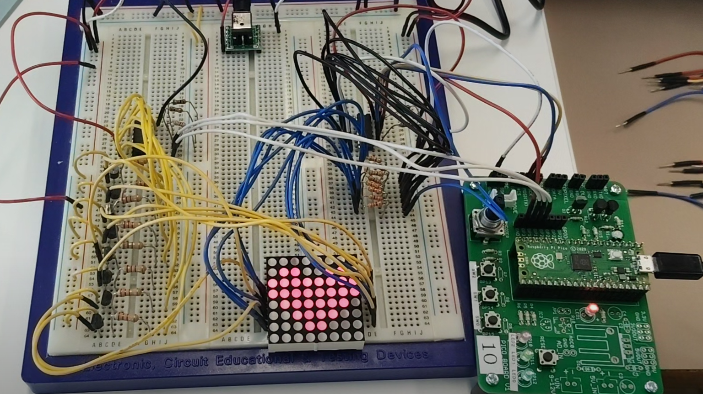

# 8×8 LEDマトリクス表示ドライバ（Raspberry Pi Pico / C言語）

動画：(https://photos.app.goo.gl/Aj9LryQogsvCSmmR6)

## 概要
Raspberry Pi Pico（RP2040）で 8×8 LEDマトリクスをダイナミック点灯させ、
文字のスクロール表示やドット絵表示を行うドライバです。
職業訓練校（船橋テクノスクール IoTシステム科）の授業で制作しました。
同級生各人で分担して様々な電子回路とドライバを作成しています。
私は2人チームでマトリクスLEDを担当し、電子回路は同級生、コードは主に私が担当しました。
現在も機能追加を続けています（今後の予定：タイマー割り込みによる表示の自動化、ファイル分割など）。

メインのコード：[Sample_matrixLED03.c](Sample_matrixLED03.c)
（Sample_matrixLED03_doc.c は学習メモ付きの作業版、old フォルダは学習過程の旧版です）

## 主な機能
- 1ドット単位の点灯制御、行・列単位の書き込み、上下左右シフト、90度回転
- OR / AND / XOR によるパターン合成、点滅表示
- 美咲フォントによる英数字・日本語の電光掲示板スクロール（半角は字詰め表示）
  日本語は wchar_t 版で対応可能。

## ハードウェア構成
| 部品 | 役割 | 接続 |
|---|---|---|
| 74HC595 | 列（カソード）制御 | SPI0：GP7=SER, GP6=SRCLK, GP3=RCLK |
| 74HC138 | 行（アノード）選択 → PNPトランジスタ | GP20=A, GP19=B, GP18=C |

## 設計の工夫
- 共用体（union）でフレームバッファを定義し、
  「8バイト一括（SPI送信用）」と「(x, y) の1ビット単位」の両方でアクセス可能。
- ハード制御層／バッファ操作層／描画層に分け、描画データと物理出力を分離。
- 表示時間を Pico SDK の絶対時刻（absolute_time）で管理し、定数を変えても動作が崩れない作りに。

## 苦労した点と解決方法
1. **残像（ゴースト）**：行を切り替える瞬間に、前の行のデータが点灯。
   → 消灯（ブランキング）してから行を切り替え、その後にデータをラッチする順番に変更。
2. **定数を変えると表示が止まる**：整数の割り算で待ち時間が0になり、無限ループに。
   → 絶対時刻による終了判定に変更。
3. **特定の1列だけがうっすら光る**：ブレッドボードでは発生せず、基板でだけ発生。
   → テスターで74HC595の出力を測ると、QAだけHが3.5Vしか出ていなかった。
     ICを交換すると5Vに戻ったため、ICの出力不良と特定。

## 開発環境
Raspberry Pi Pico SDK / C言語 / CMake / VS Code

## クレジット
- フォント：美咲フォント（2021-05-05版）Copyright(C) 2002-2021 Num Kadoma　http://littlelimit.net/
- 本リポジトリの misaki_font.h は、同フォントを AI生成のpythonスクリプト(make_font_header.py)にて、C 言語の配列データに変換したものです。

## 生成AIの利用について
フォント変換スクリプト（make_font_header.py）の生成、コードレビュー、不具合原因の調査補助、コメント文の推敲に生成AI（Claude、Gemini、NotebookLM 等）を利用しました。

作成：横須賀 昌敏（GitHub: kayabuk1）
