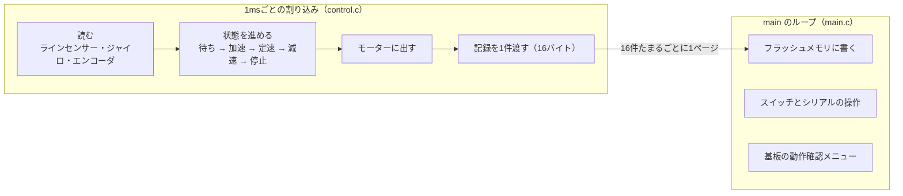

# ロボトレーサの基礎プログラム（Raspberry Pi Pico / C言語）

職業訓練校のチーム製作で、ライントレース競技用のロボット（ロボトレーサ）を作っています。白い線に沿って走る速さを競うロボットです。
私は、クラスの全員に配る「基礎プログラム」を担当しました。各自が、このプログラムを元に改良して、走りを速くしていきます。

このページは、何を作り、私が何を担当し、どう確かめたかの紹介です。
使い方と設計の詳しい説明は、[README.md](README.md) にあります。

## ひと目で

| 項目 | 内容 |
|---|---|
| マイコン | Raspberry Pi Pico（RP2040）。同じソースで、Pico 2（RP2350）向けにもビルドできます |
| 言語と環境 | C言語、Raspberry Pi Pico SDK、VS Code |
| つないでいる部品 | ラインセンサー8個（A/D変換IC MCP3008）、ジャイロ（L3GD20）、フラッシュメモリ（AT25SF321B）、モータードライバ（TB67H450）2個、エンコーダ付きモーター |
| 製作の時期 | 2026年11月〜12月（製作中） |
| 私の担当 | 基礎プログラム（各部品のドライバを1つにまとめる）、走行の記録、A/D変換ICのドライバ |
| 今の状況（2026-11-27） | 基板での確認まで終わりました。車体を組み上げている所で、**走行はこれからです** |

## 作った物

- **1msごとの制御**：センサーを読み、状態を進め、モーターを動かす処理を、1msごとの割り込みの中で行います。
  実機で測った処理の時間は、平均 約0.35ms、走行の状態での最大 約0.48ms です（Raspberry Pi Pico、2026-11-27）。
- **走行の記録**：1msごとに、センサーの値、速さ、角速度などを16バイトにまとめて、フラッシュメモリに残します。
  走行5回分を別々の場所に記録して、走行の後に、USBシリアルからCSVで読み出せます。
  時間のかかる書き込みは main の側で行い、1msごとの制御を止めません。
- **基板の動作確認メニュー**：USBシリアルからキーを送ると、スイッチ、ブザー、センサー、電源電圧、エンコーダ、モーター、ジャイロ、
  フラッシュメモリを、1つずつ確かめられます。新しい基板で、配線の間違いと部品の故障を、プログラムの不具合と分けて調べるためです。
- **安全のための停止**：ラインを見失ったとき、車輪が回っていないか逆に回っているとき、時間切れのときに、モーターを止めます。
- **設定の切り替え**：ピンの番号と部品の向きは `board.h`、走りの調整は `params.h` にまとめました。
  基板が変わっても、この2つのファイルを直せば済むようにしています。

## 私の担当と、AIの使い方

コードの大部分は、AI（Anthropic の Claude）が書きました。指導員には、AIを使っていることを伝えてあります。
誰が何をしたかを、分けて書きます。

**私がした事**

- A/D変換IC（MCP3008／MCP3208）のドライバを作りました。指導員の確認を受けています。
- フラッシュメモリ（AT25SF321B）のドライバを書き始め、ブレッドボードの上で、SPIの速さ、プルアップ抵抗、パスコンを変えて、
  書き込みと読み出しを測りました。配れる形への仕上げは、AIに頼みました。
- 何を作るかと、進め方を決めました。例：スイッチの長押しで記録を全部消して、ブザーで始めと終わりを知らせる。走行5回分を記録する。
  ジャイロは指導員のドライバを使う。PCの上の模擬の走行は増やさず、実機で測った結果で確かめる。
- 実機で確かめました。教育用の実験基板と、機体の基板で、項目ごとに画面の文字を保存して、結果をAIに渡しました。
- 不具合の原因を切り分けました（下の「不具合を見つけた例」）。
- AIが書いたコードの流れと、変えた所を、自分の言葉で説明できるように、読み進めています。

**AIに頼んだ事**

- 制御（`control.c`）、操作（`main.c`）、センサーの処理（`line_sensor.c`）、動作確認メニュー（`selftest.c`）、
  5回分の記録（`flash_log/`）のコード。
- PCの上で動かす自動の確認（部品ごとの確認 101項目、プログラム全体を模型の基板で動かす確認 183項目）。
- `README.md` の文章。実機の結果の部分は、私が保存した記録を元にしています。

**ほかの人が作った物（このリポジトリには入れていません）**

- モーターとエンコーダの制御（同級生）、ジャイロとブザーのドライバ（指導員）。

## 実機で確かめたこと

| 日付 | 確かめた環境 | 確かめた内容 |
|---|---|---|
| 2026-11-25 | 教育用の実験基板とブレッドボード（Pico） | スイッチ、ブザー、LED、フラッシュメモリへの5回分の記録（1000件ずつ書いて、5回とも読み戻しが一致）、4MB全体の消去 |
| 2026-11-27 | 機体の基板（Pico）。車体なし | センサー8個の並び、電源電圧の表示、ジャイロ（手でおよそ90度回して、計算した角度が +90.6度と -90.9度）、1msごとの処理の時間 |

走行（ラインに沿って走る、マーカーでスタートとゴールを判定する）は、まだ実機で確かめていません。
PCの上の模型では確かめていますが、模型と実機は違うので、結果としては数えていません。

## 不具合を見つけた例

1. **センサーのつながりが、設定と違っていた**
   回路図を入手してAIに渡し、回路図と設定を照らし合わせてもらった所、A/D変換ICのチャンネルの割り当てが違っていました。
   実機で、センサーを1個ずつ黒い紙に載せて、8個の並びが直ったことを確かめました。
2. **走り出して約0.15秒で止まる**
   動作確認メニューで、左のモーターを回すと、右のエンコーダの数が増えていました。
   走行の記録でも、左に +50% を出しているのに、左の速さが -1.2 m/s でした。
   担当の同級生に確認して、仮に取り付けたときに、左右を逆につないでいたと分かりました。
   安全のための停止が働いたので、モーターが回り続けることはありませんでした。
3. **端のセンサーだけ、値が変わらない**
   キャリブレーションが、毎回同じセンサーで失敗しました。古いカメラで、赤外線のLEDが光っていることを確かめたので、
   光を受ける側の部品（フォトトランジスタ）の故障と見て、指導員と相談して交換しました。交換の後、正しい値になりました。
4. **フラッシュメモリの全消去が、速すぎる**
   データシートの標準は10秒ですが、実機では約1秒で終わりました。消えていないのではと疑い、4MBの全部のバイトを読んで数える確認を、
   メニューに足してもらいました。実機で、全部のバイトが消えていることを確かめました。速い理由は、まだ分かっていません。

## 学んだこと

- 画面の文字を、テストごとに保存しておくと、後から原因を追えます。2番の入れ違いは、保存した記録から分かりました。
- 「事実」と「推測」を分けて書くと、次に何を確かめるかが決まります。4番は、推測のままにせず、中身を読んで確かめました。
- AIに任せるときも、何を作るかを決めることと、実機で確かめることは、自分の仕事として残ります。

## まだできていないこと

- 実機での走行と、走りの調整
- ジャイロを使った旋回の補正を、実機で試すこと
- コース情報の保存、その場で1回転してのキャリブレーション

## このリポジトリについて

- 入っている物：`board.h`、`params.h`、`main.c`、`control.c`、`line_sensor.c`、`selftest.c`、`sw/`、`gyro/`、
  `adc_mcp3208or3008/`、`at25sf/`、`flash_log/`、`CMakeLists.txt`、`README.md`
- 入っていない物：モーターとエンコーダの制御、ジャイロのドライバ、ブザーのドライバ（ほかの人が作った物のため）。
  そのため、このリポジトリだけでは、ビルドできません。
